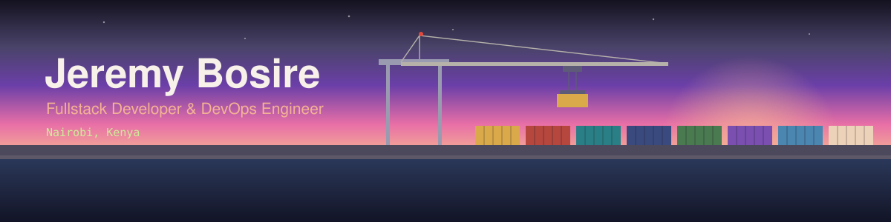

  

I'm a fullstack developer and DevOps engineer in Nairobi. I build web apps from the React frontend through the API to the database, and I care about getting them deployed and keeping them running. I graduated in Computer Science from Egerton University in 2026.

**[Open my portfolio: Port of Bosire](https://jeremy-bosire.github.io/port-of-bosire/)**
It's a small container port. You run the crane, lift a container onto the dock, and the contents (my experience, projects, skills) open up. If you'd rather just read, there's a "Skip game" button that gives you the plain version.

## Right now

I'm a Software Developer Intern at **Zamupay** (since October 2026), building **Koba**, a remittance portal with secure payments and real-time transaction tracking. The backend is .NET (C#) and the frontend is React. The code is private, but I'm happy to talk about how it's put together.

## Things I've built

| Project | What it is | Stack |
| --- | --- | --- |
| **MindHero** | A multi-tenant clinical mental health platform. Facility-scoped data, three roles (admin, therapist, client), invite-only sign-up, an AI counselor built on the Claude API, and a therapist dashboard with mood and sleep trends. | Python, Flask, React, TypeScript, SQLAlchemy, JWT |
| **PovertyLine** | A mobile-first platform for distributing resources, with separate access for users, providers and admins. | Python, Flask, React, Redux Toolkit, PostgreSQL, Docker |
| **Simple Shell & printf** | A UNIX shell and a custom `printf`, written in C from scratch. [printf repo](https://github.com/Jeremy-Bosire/printf) | C, Linux |
| **Tower Defense** | A 2D strategy game with enemy pathfinding and waves that get harder as you win. | Python, Pygame |
| **TAKA** | An assignment tracker for students, with deadlines and progress. | React |

<!-- Add repo links for MindHero, PovertyLine, Tower Defense and TAKA once they are public. -->

## What I work with

| Frontend | Backend | Data | DevOps and cloud |
| --- | --- | --- | --- |
| React, Next.js, TypeScript, Redux Toolkit, Tailwind CSS | Python (Flask, FastAPI), C# and .NET, REST, JWT and RBAC | PostgreSQL, SQL | Docker, Kubernetes, Terraform, GitHub Actions, AWS (EC2, S3, Lambda), Linux |

I test with Jest and Pytest, and I use AI tools (Claude, Gemini, Cursor, Copilot) in my daily workflow.

## Open source

I've had changes merged into **[NumPy](https://github.com/numpy/numpy)** (performance work) and **[psf/black](https://github.com/psf/black)** (code quality).

## Hackathons

- **Global semifinalist**, A2SV AI for Impact 2024. We were the only team from Kenya among 690+ entries.
- **1st runners-up**, Power Learn Project inter-university hackathon 2024. We built a translation-enabled messaging prototype, Bonga Plus, in four hours.
- **2nd runners-up**, NRF CyberSecurity Hackathon 2024. I led a team of five against 30+ teams.
- **Best Technical Presenter**, Build with AI Hackathon, GDG Nairobi 2024.

## Training

- DevOps Engineering, Moringa School (completed August 2025)
- Software Engineering, Moringa School and ALX Africa
- Claude in Action, Anthropic Academy (2026)

## Elsewhere

I also make AI content, and I was a delegate at the Africa Forward Summit in Kenya in 2026.

[Portfolio](https://jeremy-bosire.github.io/port-of-bosire/) · [LinkedIn](https://www.linkedin.com/in/jeremy-bosire-3004b51a7/) · [Email](mailto:bnjeremy.ke@gmail.com) · [TikTok](https://www.tiktok.com/@bn.jeremy) · [Instagram](https://www.instagram.com/bn.jeremy) · [X](https://twitter.com/BosireNyaachi)

I'm open to fullstack, backend and DevOps roles, including remote teams.
